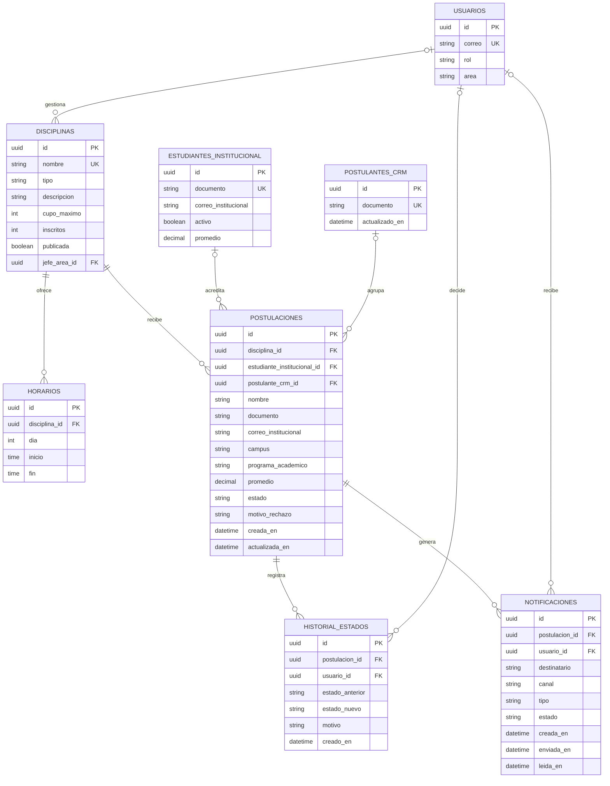

# Arquitectura del portal

React, Vite y Tailwind presentan el catálogo y el formulario. Express expone la API REST. Las rutas delegan en controladores HTTP, que invocan servicios y repositorios. Prisma conecta los repositorios con PostgreSQL. El paquete compartido contiene los contratos y el esquema Zod que validan tanto la interfaz como la API.

La Iteración 1 aplica la migración de disciplinas, horarios y postulaciones. La API devuelve el radicado una vez que PostgreSQL confirma la escritura. El horario usa el día ISO de la semana y columnas de hora local. El promedio declarado se guarda como un decimal de dos posiciones.

## Modelo objetivo de las tres iteraciones

En la Iteración 2, el adaptador institucional aportará el estado activo y el promedio oficial. Las postulaciones elegibles se vincularán a una ficha CRM única por documento. Las transiciones y las notificaciones se registrarán en PostgreSQL. El procesamiento de correos tendrá reintentos.

En la Iteración 3, la API restringirá los paneles por rol JWT y área. Las aprobaciones alimentarán el consolidado y la asignación de plaza comprobará el cupo y actualizará el contador y el estado de la postulación dentro de una sola transacción.
